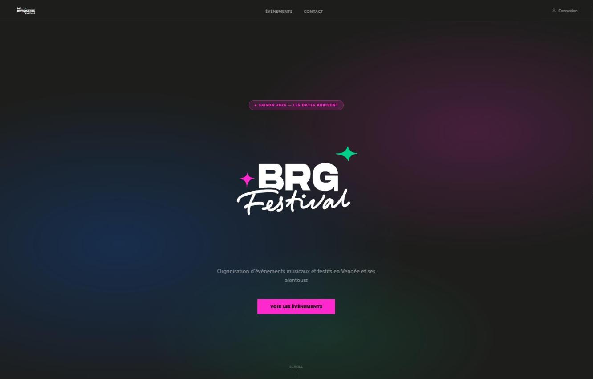
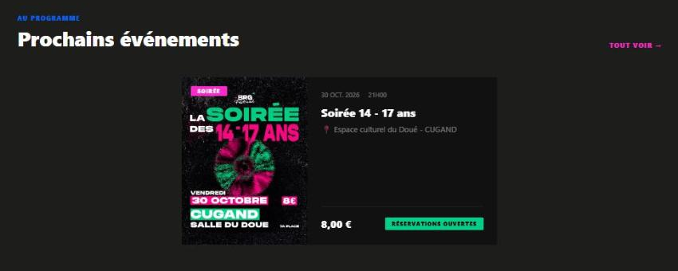
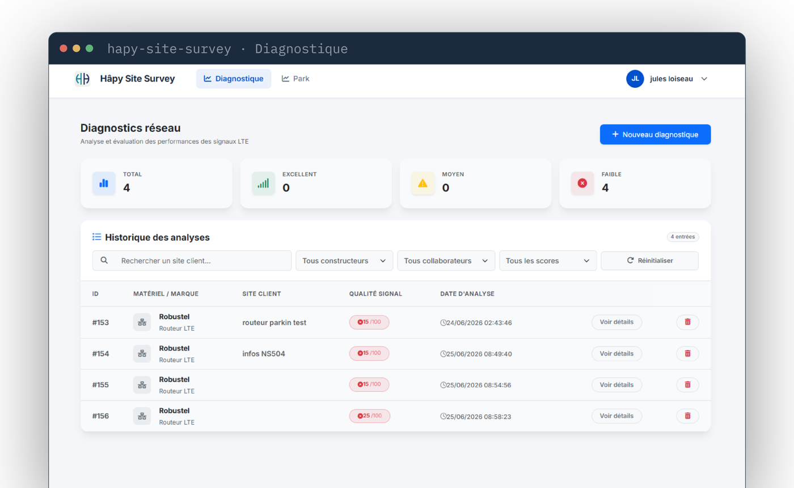
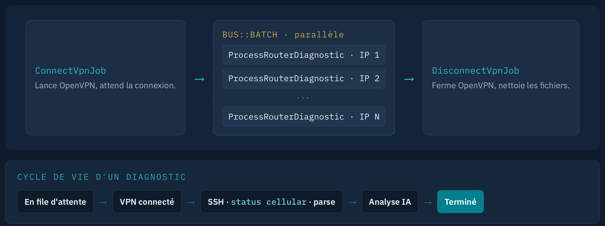

# Jules Loiseau — Développeur web & applicatif

Étudiant en **BTS SIO option SLAM** (2ᵉ année, Campus Notre Dame du Roc, 2025–2027), je développe principalement en **Laravel**, avec du **C#**, du **Flutter** et du **React** selon les projets.
Je recherche un **stage du 4 janvier au 12 février 2027**, puis une **alternance**.

📫 [LinkedIn](https://www.linkedin.com/in/jules-loiseau-9890162bb) · ✉️ jules.loiseau85@gmail.com

---

## 🎉 La Bringuerie — billetterie et gestion d'événements

> Projet réel, en production · [la-bringuerie-festival.fr](https://www.la-bringuerie-festival.fr/)

Site et billetterie de **La Bringuerie**, l'association d'événements festifs pour les jeunes en Vendée que je co-préside. J'ai conçu, développé et mis en production l'application de A à Z (juillet 2026), et je la maintiens. Elle gère aujourd'hui les ventes pour une soirée de 650 personnes.

**Stack** : Laravel 13 · PHP 8.3 · Blade · Livewire · Tailwind CSS / DaisyUI · Spatie Permission · HelloAsso · files d'attente Laravel · serveur Apache OVH

**Ce qui se démarque**
- **Paiement en ligne via l'API HelloAsso** (flux *Checkout Intent*), avec un webhook sécurisé : vérification de secret, routes signées, idempotence en cas de rejeu.
- **Billets avec QR code** générés à l'achat et envoyés par e-mail en file d'attente.
- **Webapp de scan pour les bénévoles** : contrôle des billets en continu à l'entrée, depuis un téléphone.
- **Gestion des bénévoles et des rôles** (Spatie), statut des événements calculé automatiquement.
- **Audit de sécurité avant la mise en ligne** : configuration de production, validation stricte des e-mails, nettoyage des billets orphelins, rotation des secrets.
- Interface responsive et animée, consentements CGV et droit à l'image, mentions légales.

---

## 📡 Hâpy Site Survey — diagnostic du signal LTE par IA

> Stage de 1ʳᵉ année chez Hâpy (prestataire IT, IIoT & cybersécurité) · juin 2026 · code propriétaire, non publié

Outil interne qui mesure la qualité du signal 4G des routeurs installés chez les clients, pour piloter des automates ou des bornes de recharges, et la transforme en **diagnostic lisible** : un score sur 100, une explication et une action recommandée pour le technicien.

**Stack** : Laravel 13 · PHP 8.3 · MySQL · Blade · files d'attente (`Bus::batch`) · OpenVPN · SSH (Symfony Process) · API Anthropic · Spatie Permission · Google 2FA

**Ce qui se démarque**
- **Trois modes de diagnostic** : saisie manuelle des mesures radio, connexion SSH automatique à un routeur, ou analyse d'une **plage d'IP entière** en arrière-plan avec suivi en temps réel et export CSV.
- **Pipeline VPN → SSH → IA** : ouverture du tunnel OpenVPN, jobs parallèles par routeur, lecture et parsing de l'état cellulaire, puis analyse par IA avec une réponse JSON structurée et stockable.
- **Multi-constructeurs** (Robustel, InHand, Milesight…) : j'ai écrit le script de normalisation pour les routeurs Milesight.
- **Sécurité** : double authentification Google Authenticator imposable par l'admin, rôles et permissions, policies sur chaque modèle.

---

## 🛒 Alizon — système d'information d'une entreprise de vente

> Projet BTS SIO2 · en cours (2026–2027)

Un même système décliné en plusieurs applications qui partagent une API commune : web, bureau et mobile.

| Brique | Rôle | Stack | État |
|---|---|---|---|
| **ali-api** | API REST centrale | Laravel 13, Sanctum, Pest, GitLab CI | ✅ fonctionnelle |
| **ali-purchase** | Application bureau des achats | C# / WPF, MVVM, injection de dépendances | 🚧 en cours |
| **ali-inventory** | Application mobile d'inventaire | Flutter, MVVM | 🚧 en cours |
| **ali-sales** | Application web des ventes | Laravel + Vue / TypeScript | 🚧 démarrage |

**Ce qui se démarque**
- **API versionnée** (`/api/v1`) avec authentification par token **Sanctum**, Form Requests, API Resources et middleware de journalisation.
- **Tests Feature Pest** sur les endpoints catégories, clients et commandes, exécutés par une **pipeline GitLab CI**. Les tests ont permis de corriger de vrais bugs de validation.
- **Client C# en architecture en couches** (Views, ViewModels, Services, Repositories, couche HTTP) branché sur l'API réelle, livré par sprints.
- Travail en branches et merge requests.

---

## 🏠 OAGTI — gestion d'agence immobilière

> Projet BTS SIO · réalisé en binôme · 2026

Application web de gestion pour une agence immobilière : du bien à la publication de l'annonce.

**Stack** : Laravel · PHP · Blade · MySQL

**Ce qui se démarque**
- Gestion des **biens**, **propriétaires**, **mandats** et **diagnostics**, avec photos et statuts.
- Cycle de vie d'un bien : création, édition, **publication** et retrait.
- Tableau de bord et annuaire des propriétaires.
- Gestion des utilisateurs (création, édition, activation et désactivation des comptes).

---

Les dépôts de cours sont hébergés sur le GitLab de mon établissement. Captures et démonstrations disponibles sur demande.
